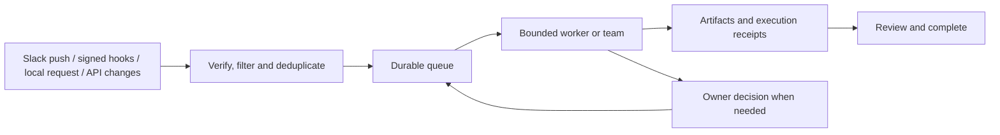

# Saha

A local work agent that receives events, runs bounded AI workers, and keeps a durable
record of decisions and deliverables. Install it for **your own** accounts and workflow.
No personal workspace IDs, credentials, conversation history or model subscriptions
are included.

**Status: early local pilot, version 0.2.0.** Saha can run work without a prompt for
every step, within configured responsibilities. It is not a complete replacement
for a person, a production deployment agent, or a multi-user hosted service.

## Get started

Requires Python 3.11+ on macOS or Linux. The demo needs no AI account.

```sh
git clone https://github.com/suhaib-ghl/saha-agent.git
cd saha-agent
python3 -m venv .venv
source .venv/bin/activate
python -m pip install .
saha init
saha doctor
saha serve
```

In another terminal, activate that venv and run `saha open`. Submit a demo job,
answer its decision, inspect the generated note, and mark it reviewed. Then configure
an authenticated Codex or Claude Code installation and select a real worker.

Your config lives at `~/.saha/config.json`; your ledger, private logs and task files
live under `~/.saha/state/`. No config or credentials are inherited from the author.
`SAHA_HOME`, `SAHA_CONFIG`, `SAHA_STATE`, `--config` and `--state` support other
profiles. Each person must use their own credentials and permissions.

[Full installation, background startup, upgrade and uninstall](docs/INSTALLATION.md)

## What it does

| Capability | Implemented behavior |
|---|---|
| Durable work queue | SQLite inbox, deduplication, scoped responsibilities and one active job |
| Codex | Local implementation and sandboxed commands/tests |
| Claude Code | Restricted file-based analysis/editing; no Bash in this adapter |
| Team | Codex engineer, separate Claude reviewer, at most one repair round |
| Desktop | Official Computer Use via Codex app-server; genuine live owner approvals |
| Slack | Optional Socket Mode event intake with channel and sender allowlists |
| GitHub / ClickUp | Explicit read-only API adapters, identity checks and change-driven enqueueing |
| Decisions and memory | Durable owner feedback, scoped saved instructions, reviewable artifacts |
| Interoperability | Read-only MCP, skills, commands and a session-status hook |

The runtime is adapter-based; it currently supports **Codex and Claude Code**, not
arbitrary providers automatically. Each CLI uses its own installed login and billing.
Native desktop support is verified on macOS with a compatible official host; it is
optional and not bundled. New sessions may need approval. No always-available
computer access is promised.

## How work starts



Slack Socket Mode and accepted webhooks wake the queue directly. GitHub/ClickUp API
scanners currently poll every 30 seconds; unchanged scans make no model calls. A
new installation establishes a baseline rather than replaying all old work. Local
queue checks do not scan apps or invoke models. Computer-use access alone is not an
event listener. Jobs still wait when another job is active, limits are reached, or
the machine is asleep/offline.

A task decision starts a new worker with a durable handoff. A **live tool permission**
answers the waiting tool in the same worker. The dashboard distinguishes these.
The process of reviewing artifacts and marking complete remains explicit.

## Scope and limits

- One OS user owns an instance. Do not expose its dashboard publicly or share owner keys.
- Jobs run in isolated directories, not automatically in company repositories.
- No external messages, pushes, merges, deployments, refunds, or automatic ticket closure.
- No automatic Facebook intake, native voice calls, or broad app monitoring.
- Saved owner feedback changes future context; it does not retrain model weights or
  turn third-party messages into permission.
- Default limits: 10 minutes per job, 20 job starts per UTC day, bounded attempts,
  8 MB output per child and a Claude per-invocation cost limit. Codex has no hard
  dollar/token cap in this project. Team jobs can contain multiple model invocations.
- Codex app-server is experimental. The bundled adapter must be revalidated when the
  vendor protocol, plugins or OS permissions change.

## Documentation

- [Installation and first job](docs/INSTALLATION.md)
- [Configuration, integrations, profiles and MCP](docs/CONFIGURATION.md)
- [Slack setup](docs/SLACK-SETUP.md)
- [Architecture and extension points](docs/ARCHITECTURE.md)
- [Troubleshooting](docs/TROUBLESHOOTING.md)
- [Migration from the private pilot](docs/MIGRATION.md)
- [Verification and supported environments](VERIFICATION.md)
- [Changelog](CHANGELOG.md) · [Contributing](CONTRIBUTING.md) · [Security](SECURITY.md)

## Development

```sh
python -m pip install -e .
python -m unittest discover -s tests -v
python -m compileall -q saha_agent scripts tests
node --check saha_agent/web/app.js  # Node is optional for this syntax check
python scripts/package.py        # allowlisted source export, without runtime data
```

CI exercises the portable core on macOS and Linux. Live vendor logins, external
accounts and native app permissions are not supplied to CI. See verification notes
for what a passing core suite does and does not prove.

## License

[MIT](LICENSE). Third-party CLIs, hosts and services remain subject to their own
terms. Installing Saha does not grant access to another person's accounts.
